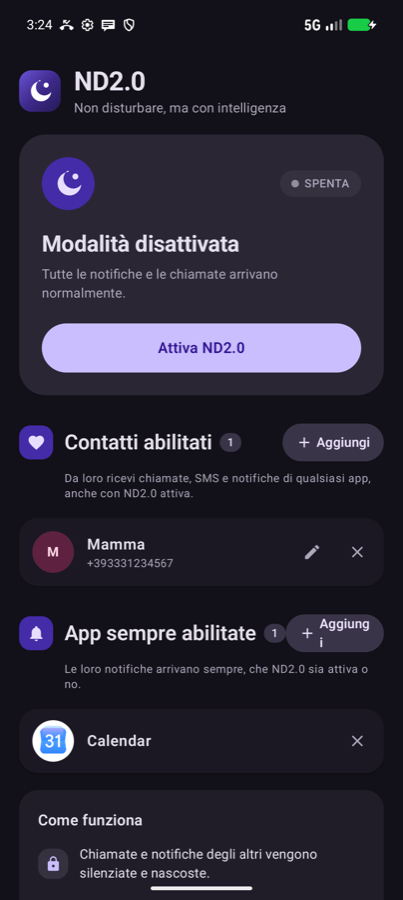
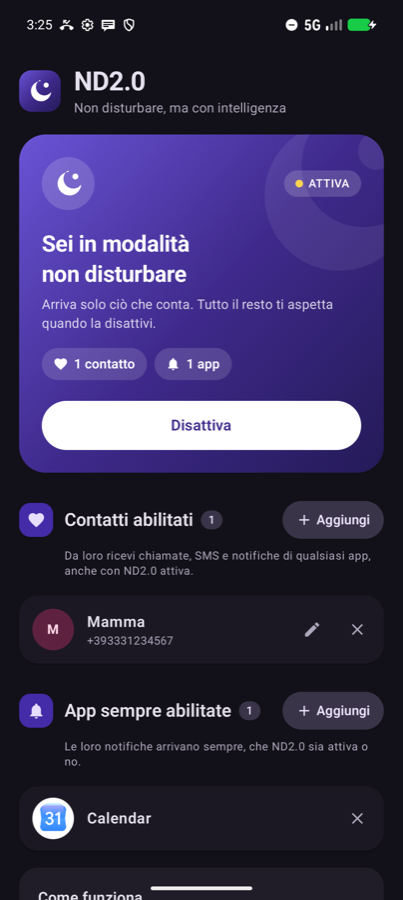

<div align="center">


# ND2.0

**Non disturbare, ma con intelligenza.**

Una modalità "Non disturbare" per Android che lascia passare solo le persone e le app che contano davvero.

[](https://github.com/carellice/ND2.0/releases/latest/download/ND2.0.apk)
&nbsp;

&nbsp;


</div>

---

## ✨ Cosa fa

Il "Non disturbare" classico è tutto o niente. ND2.0 ti fa scegliere **chi** e **cosa** può raggiungerti.

### 💜 Contatti abilitati
Scegli alcune persone, per esempio mamma, papà e i nonni. Con la modalità attiva da loro ricevi **tutto**: telefonate, SMS e notifiche di qualsiasi app (WhatsApp, Telegram, Instagram…). Da tutti gli altri non arriva nulla.

### 🔔 App sempre abilitate
Scegli le app che non vuoi mai perdere, per esempio Gmail o Google Calendar. Le loro notifiche arrivano **sempre**, che la modalità sia attiva o no.

### 🌙 E in più
- **Non si perde niente.** Le notifiche bloccate restano da parte e ricompaiono quando disattivi la modalità.
- **Altri nomi.** Se una persona compare nelle app con un altro nome (es. username Instagram), aggiungilo e ND2.0 la riconosce lo stesso.
- **Pulsante rapido.** Attivi e disattivi ND2.0 dalle Impostazioni rapide, senza aprire l'app.
- **Aggiornamenti integrati.** Nelle Impostazioni l'app controlla se c'è una nuova versione e la scarica e installa da sola.

## 📱 Screenshot

<div align="center">

&nbsp;&nbsp;&nbsp;

</div>

## 📥 Installazione

1. Scarica **[ND2.0.apk](https://github.com/carellice/ND2.0/releases/latest/download/ND2.0.apk)** dall'ultima release.
2. Aprilo sul telefono e consenti l'installazione da questa fonte.
3. Al primo avvio segui la card **"Completa la configurazione"**.

| Permesso | A cosa serve |
|---|---|
| Accesso alle notifiche | Filtrare le notifiche delle app (obbligatorio) |
| Accesso a Non disturbare | Silenziare tutto il resto (obbligatorio) |
| Contatti | Scegliere e riconoscere i contatti |
| Telefono e registro chiamate | Riconoscere chi chiama e far squillare |
| Notifiche | Mostrare ciò che passa il filtro |

> **Android 13+:** se l'accesso alle notifiche risulta bloccato come "impostazione con restrizioni", vai su *Impostazioni → App → ND2.0 → ⋮ → Consenti impostazioni con restrizioni*.

## ⚙️ Come funziona

- **Regola di sistema.** Quando attivi ND2.0, l'app accende una regola *Non disturbare* di sistema chiamata "ND2.0". La regola silenzia e nasconde chiamate e notifiche, mentre sveglie e media restano attivi.
- **Filtro notifiche.** Un `NotificationListenerService` riconosce le notifiche dei contatti e delle app abilitate. Le ripropone su un canale che ignora il Non disturbare, con lo stesso testo, lo stesso tap e gli stessi pulsanti (es. "Rispondi").
- **Riconoscimento dei contatti.** Il contatto viene riconosciuto dal numero (`tel:`), dall'email, dal mittente dell'ultimo messaggio o dal nome nel titolo. Nei gruppi conta solo chi ha scritto l'ultimo messaggio.
- **Chiamate.** Quando chiama un contatto abilitato, ND2.0 fa squillare il telefono e mostra "Rispondi" e "Rifiuta".

## 🛠️ Sviluppo

```bash
./gradlew assembleDebug
adb install -r app/build/outputs/apk/debug/app-debug.apk
```

Per pubblicare una nuova versione basta fare doppio clic su **`release.command`**. Lo script:
- incrementa la versione;
- compila l'APK;
- crea la release su GitHub;
- elimina le release precedenti.

## ⚠️ Limiti noti

- Nelle app di messaggistica il contatto viene riconosciuto dal nome mostrato nella notifica, che deve corrispondere al nome in rubrica o a uno degli "Altri nomi".
- Le notifiche che passano il filtro compaiono come "ND2.0", con il nome dell'app originale accanto.
- Su Android 15+ il *raffreddamento notifiche* può abbassare il volume se arrivano molte notifiche di fila.

---

<div align="center">
Fatto con 💜 da Flavio
</div>
